# Criação de Skills — Refatoração Arquitetural Automatizada

Criei uma skill que analisa, audita e refatora qualquer projeto para o padrão MVC, independente da tecnologia. Usei essa skill nos três projetos deste repositório e documentei o processo e os resultados aqui.

Este README é o guia rápido para rodar a skill e os três projetos refatorados.

- Documentação completa do que foi feito: [`doc.md`](doc.md)
- Relatórios de auditoria: [`reports/`](reports/)
- Skill: `.claude/skills/refactor-arch/` dentro de cada projeto

## Pré-requisitos

| Ferramenta | Versão usada |
|---|---|
| opencode (ou Claude Code) | versão atual, com suporte a Skills |
| Python | 3.12+ |
| Node.js / npm | 20+ / 10+ |
| curl (opcional) | para testar os endpoints |

> Depois de criar ou alterar uma skill, reinicie o opencode para que ele carregue a configuração e a skill.

## Estrutura do repositório

```text
mba-ia-refactor-projects-skill/
├── README.md                       # este guia de execução
├── doc.md                          # registro completo do que foi feito
├── reports/
│   ├── audit-project-1.md
│   ├── audit-project-2.md
│   └── audit-project-3.md
├── Evidencias/
│   ├── 1.png                       # invocação da skill
│   ├── AntesRefatoracao/           # prints por projeto
│   └── DepoisRefatoracao/          # prints por projeto
├── code-smells-project/            # Python + Flask (E-commerce)
│   ├── .claude/skills/refactor-arch/
│   ├── .claude/commands/refactor-arch.md
│   ├── .opencode/command/refactor-arch.md
│   ├── opencode.json
│   └── ...
├── ecommerce-api-legacy/           # Node.js + Express (LMS/checkout)
│   ├── .claude/skills/refactor-arch/
│   ├── .claude/commands/refactor-arch.md
│   ├── .opencode/command/refactor-arch.md
│   ├── opencode.json
│   └── src/
└── task-manager-api/               # Python + Flask (Task Manager)
    ├── .claude/skills/refactor-arch/
    ├── .claude/commands/refactor-arch.md
    ├── .opencode/command/refactor-arch.md
    ├── opencode.json
    └── ...
```

## O que a skill faz

A ideia é que ela seja agnóstica de tecnologia e consiga, em qualquer codebase:

- detectar a linguagem, o framework e a arquitetura atual;
- identificar anti-patterns e code smells, classificando por severidade com arquivo e linha exatos;
- gerar um relatório de auditoria estruturado com todos os achados;
- refatorar o projeto para o padrão MVC (Model-View-Controller), eliminando os problemas encontrados;
- validar o resultado para garantir que a aplicação continua funcionando depois das mudanças.

## Análise manual

Antes de automatizar, fiz a auditoria na mão dos três projetos. Isso me ajudou a entender quais padrões a skill precisava detectar.

### Projeto 1 — `code-smells-project` (Python/Flask, monolito)

Arquivos analisados: `app.py`, `models.py`, `controllers.py`, `database.py`.

#### CRITICAL / HIGH

O ponto mais grave é o par de endpoints administrativos em `app.py:47-78`. O `/admin/query` recebe uma string SQL do corpo da requisição e executa direto no banco (`app.py:69`), sem autenticação e sem allowlist. Na prática é execução remota de comandos no SQLite. O `/admin/reset-db` (`app.py:47-57`) apaga todas as tabelas com um POST anônimo.

Na mesma linha, a `SECRET_KEY` está fixa em `app.py:7`.

A camada de dados tem SQL Injection sistemática. Em `models.py` praticamente toda query é montada por concatenação de string — `get_produto_por_id` (`models.py:28`), o login (`models.py:109-111`) e a busca com filtros (`models.py:289-299`) são exemplos. O login é o caso mais crítico: dá para injetar condição sempre-verdadeira e entrar sem senha.

Ainda em autenticação: as senhas são gravadas em texto puro no seed (`database.py:75-83`) e a listagem de usuários devolve o campo `senha` (`models.py:79-86`), exposta por `controllers.listar_usuarios`. Não há hash em lugar nenhum.

#### MEDIUM

O N+1 está concentrado na leitura de pedidos. `get_pedidos_usuario` (`models.py:171-201`) abre um cursor por pedido e outro por item; `get_todos_pedidos` (`models.py:203-233`) repete o padrão. Com 50 pedidos e 3 itens cada, isso passa de 150 idas ao banco para uma única chamada. `criar_pedido` também reconsulta o preço no segundo loop (`models.py:154-156`) mesmo já tendo o produto carregado.

A validação de payload é irregular. Ex: comparar `preco < 0` (`controllers.py:43`) sem converter tipo quebra com `TypeError` se vier string. E `login`/`atualizar_status_pedido` chamam `request.get_json()` sem tratar corpo vazio (`controllers.py:169`, `:239`).

#### LOW

Magic numbers no cálculo de desconto (`models.py:256-262`) e nos status; variáveis genéricas (`e`, `row`, `prod`) e shadow de builtin `id`; imports mortos (`os` em `database.py:2`, `sqlite3` em `models.py:2`); e `print` usado como logging em toda a base.

### Projeto 2 — `ecommerce-api-legacy` (Node.js/Express, LMS com checkout)

Arquivos analisados: `src/app.js`, `src/AppManager.js`, `src/utils.js`.

#### CRITICAL / HIGH

Os segredos estão todos hardcoded em `utils.js:1-7`: senha de banco, chave live do gateway de pagamento e usuário de SMTP. Pior do que estar no código é o que se faz com ele — `AppManager.js:45` faz `console.log` do número do cartão junto com a chave do gateway a cada checkout. Isso é vazamento de dado sensível em log (PCI) e expõe a credencial para quem tiver acesso aos logs.

A "criptografia" de senha em `utils.js:17-23` (`badCrypto`) não é hash — é base64 repetido e truncado em 10 caracteres, revertível/colidível trivialmente.

Também há estado global mutável em `utils.js:9-10` (`globalCache`, `totalRevenue`), compartilhado entre requisições sem controle. E `DELETE /api/users/:id` (`:131-137`) apaga o usuário mas deixa matrículas e pagamentos órfãos, ignorando erro e respondendo 200 sempre — além de não ter autenticação, assim como o relatório financeiro.

#### MEDIUM

Todo o cálculo e a orquestração do checkout estão dentro do handler da rota (`:28-78`), com callbacks aninhados de três ou quatro níveis. Não há `try/catch` nem middleware de erro no `app.js`; cada callback trata o erro devolvendo `res.status(...).send(...)` na mão. É fácil cair em resposta dupla ou em `res` já enviado quando um callback dispara depois de outro falhar.

O relatório financeiro (`:83-128`) faz uma query por curso, uma por matrícula, mais duas por matrícula (usuário e pagamento) — N+1 clássico. Pior: o controle de "quando terminou" usa contadores `coursesPending`/`enrPending` decrementados nos callbacks. Funciona no caso feliz, mas um erro em qualquer branch pode dessincronizar o contador e a resposta nunca ser enviada. Uma query com JOIN resolveria de forma mais simples e previsível.

#### LOW

`let` em vez de `const` em quase todo o `AppManager.js`. Números mágicos: porta 3000 (`utils.js:6`), prefixo `"4"` do cartão, `10000` iterações e os `substring(0,2)`/`(0,10)` do hash. Nomes genéricos e crípticos no checkout (`u`, `e`, `p`, `cid`, `cc`). Funções utilitárias mal nomeadas (`logAndCache`, `badCrypto`) e export de `totalRevenue` sem uso.

### Projeto 3 — `task-manager-api` (Python/Flask, parcialmente organizado)

Arquivos analisados: `app.py`, `database.py`, `models/`, `routes/`, `services/`, `utils/`.

#### CRITICAL / HIGH

Credenciais fixas: `SECRET_KEY` em `app.py:13` e senha de e-mail em `services/notification_service.py:10`. `DEBUG=True` em `app.py:34`.

Senha com MD5 sem salt (`models/user.py:29`, `:32`) e — o achado mais sério depois das credenciais — `to_dict` devolve o hash da senha (`models/user.py:21`). Como esse `to_dict` é usado nas respostas (`user_routes.py:85`, `:129`, `:209`), o hash vaza em `/users`, `/users/<id>` e no login. Some-se a isso o token fake (`user_routes.py:210`) e a ausência de proteção em qualquer rota: dá para apagar usuário/task sem autenticação.

#### MEDIUM

Tratamento de erro é o oposto de centralizado: muitos `except:` nus, sem tipo e sem log consistente (`task_routes.py:62`, `:137`, `:204`, `:236`; `user_routes.py:130`, `:149`; `report_routes.py:186`, `:207`, `:221`). Isso engole desde erro de banco até bug de programação como "Erro interno", dificultando diagnóstico. Não existe `@app.errorhandler` nem middleware comum. A validação também está duplicada: as mesmas regras de status/prioridade aparecem em `create_task`, `update_task` e em `utils/helpers.py:74-89`. E `app.py:30-31` roda `db.create_all()` no import do módulo, sem app factory — funciona, mas dificulta testes e migrações.

#### LOW

Status e prioridades são strings/inteiros soltos repetidos em vários arquivos; o mapeamento prioridade→rótulo (`critical..minimal`) está hardcoded em `report_routes.py:24-28`, `:84-88`; `utils/helpers.py:110-116` define constantes que ninguém importa. Nomenclatura mistura inglês (identificadores) com português (mensagens). Imports mortos em quase todos os arquivos (`app.py:7`, `task_routes.py:7`, `report_routes.py:7-8`, `user_routes.py:6`, `models/task.py:3`, `helpers.py:3-7`). Uso de `type(x) == list` em vez de `isinstance` (`task_routes.py:141`, `:210`). Sem paginação nas listagens. Variável genérica `d` em `models/category.py:14`.

## Construção da skill

A skill está em `.claude/skills/refactor-arch/`, com a mesma cópia nos três projetos:

```text
.claude/skills/refactor-arch/
├── SKILL.md
└── references/
    ├── project-analysis.md       # heurísticas de stack, banco, domínio e arquitetura
    ├── anti-patterns.md          # catálogo com sinais de detecção e severidades
    ├── report-template.md        # formato exato do relatório da Fase 2
    ├── mvc-guidelines.md         # responsabilidades de cada camada MVC
    ├── refactoring-playbook.md   # transformações antes/depois
    └── validation.md             # checklist de boot, endpoints e regressão
```

### Decisões do `SKILL.md`

- Três fases sequenciais com saídas padronizadas: Análise → Auditoria → Refatoração.
- Gate humano obrigatório: a Fase 2 termina com
  `Phase 2 complete. Proceed with refactoring (Phase 3)? [y/n]` e nenhum arquivo
  de código é alterado antes do `y`.
- Todo finding precisa de `arquivo:linha` exatos; a skill não pode inventar achados.
- Contrato HTTP preservado: paths e métodos continuam os mesmos. Endpoints
  perigosos podem ser desativados ou restritos, mas a decisão é registrada.
- Segredos nunca são reproduzidos por inteiro; o relatório mascara os valores.
- Projetos já organizados são evoluídos, não reescritos.

### Catálogo e playbook

O catálogo tem **25 anti-patterns** (6 CRITICAL, 6 HIGH, 7 MEDIUM e 6 LOW),
incluindo os que aparecem nos três projetos: credenciais hardcoded, SQL Injection,
God Class/File, senha em texto puro/weak hash, exposição de dados sensíveis, N+1,
validação duplicada, estado global mutável, callback hell e APIs deprecated.
Priorizei esses padrões porque aparecem nos três projetos e são os de maior impacto
arquitetural/segurança, com sinais de detecção acionáveis (ex.: query dentro de
`for`, senha em `to_dict`, `SELECT` sem `LIMIT`). Há também uma tabela de APIs
obsoletas com o equivalente moderno (`datetime.utcnow()`, `Query.get()`,
`new Buffer()`, `url.parse()`, `crypto.createCipher`, `body-parser` etc.). No
Projeto 3, `datetime.utcnow()` e `Query.get()` foram detectados e substituídos;
no Projeto 2, o scan registrou dependências transitivas desatualizadas.

O playbook tem **15 transformações** com exemplos antes/depois: config por env,
queries parametrizadas, quebra de God Class/File, rotas finas + controllers, erro
centralizado, eliminação de N+1, hash forte de senha, transações, injeção de
dependência, validação centralizada, remoção de dados sensíveis, APIs modernas,
paginação, async/await e restrição de endpoints perigosos.

### Como a skill é agnóstica de tecnologia

1. A Fase 1 procura manifests (`package.json`, `requirements.txt`, etc.), imports
   e padrões de bootstrap.
2. O MVC alvo é descrito por responsabilidades, não por caminhos fixos; há
   exemplos para Flask e Express.
3. O playbook mostra as mesmas transformações nas duas stacks.
4. A validação é genérica: boot + smoke test dos endpoints inventariados.
5. A skill não contém nome de projeto, caminho absoluto nem regra exclusiva de um
   dos três repositórios.
6. O catálogo de APIs deprecated cobre Python/Flask/SQLAlchemy e Node/Express.

### Desafios e soluções

| Desafio | Solução |
|---|---|
| Preservar contratos ao corrigir segurança | Rotas mantidas; `/admin/query` responde 410, `/admin/reset-db` exige token, a auth admin do Projeto 2 é opt-in e o Projeto 3 usa `AUTH_REQUIRED`. |
| Projeto 2 com callbacks e transações | Wrappers Promise, fila de transações e `async/await`; o checkout inteiro roda em transação. |
| Projeto 3 já parcialmente organizado | Extração incremental de controllers, config, middlewares e validators, sem recriar models/services. |
| N+1 nos relatórios | JOIN, `group_by` e `joinedload`; uma query para o relatório financeiro e agregações no Task Manager. |
| Datas deprecated no SQLite | Helper `utcnow()` com `datetime.now(timezone.utc)` e remoção do `tzinfo` para manter compatibilidade. |
| Validação real | Smoke tests com 35, 20 e 31 requisições, além do boot real dos três apps. |

Detalhes completos das decisões e do inventário de arquivos: [`doc.md`](doc.md).

## Como executar a skill `/refactor-arch`

### No opencode

```bash
cd code-smells-project
opencode
```

Dentro do opencode:

```text
/refactor-arch
```

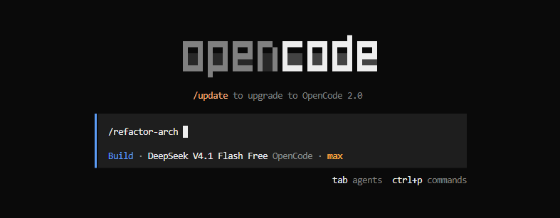

A skill roda em três fases:

1. **Fase 1 — Análise:** detecta stack, banco, domínio, arquitetura e endpoints.
2. **Fase 2 — Auditoria:** gera o relatório com `arquivo:linha`, salva em
   `../reports/audit-project-N.md` e **para**, perguntando:
   `Phase 2 complete. Proceed with refactoring (Phase 3)? [y/n]`.
3. **Fase 3 — Refatoração:** só depois do `y`, reestrutura para MVC e valida boot +
   endpoints.

Para os outros projetos, é só entrar na pasta correspondente:

```bash
cd ../ecommerce-api-legacy
opencode
/refactor-arch

cd ../task-manager-api
opencode
/refactor-arch
```

### No Claude Code

A skill também está no path canônico do Claude Code:

```bash
cd code-smells-project
claude "/refactor-arch"
```

O comando equivalente está em `.claude/commands/refactor-arch.md`.

### Onde a skill está configurada

Cada projeto tem um `opencode.json`:

```json
{
  "$schema": "https://opencode.ai/config.json",
  "skills": {
    "paths": [".claude/skills"]
  }
}
```

Assim dá para manter a skill em `.claude/skills/refactor-arch/` (o path exigido pelo
desafio) e carregá-la no opencode.

## Como rodar cada projeto

> Os projetos 1 e 3 usam a porta `5000` por padrão. Rode um por vez ou defina
> `PORT` para evitar conflito.

### Projeto 1 — `code-smells-project` (Flask)

```powershell
cd code-smells-project
python -m venv .venv
.\.venv\Scripts\Activate.ps1        # Linux/macOS: source .venv/bin/activate
pip install -r requirements.txt

# opcional, mas recomendado
$env:SECRET_KEY="sua-chave-forte"
$env:ADMIN_TOKEN="seu-token-admin"

python app.py
```

- URL: `http://127.0.0.1:5000`
- SQLite `loja.db` é criado/populado no primeiro boot.
- `POST /admin/reset-db` exige `X-Admin-Token`.
- `POST /admin/query` responde `410 Gone` (endpoint desativado por segurança).
- Variáveis em `.env.example`.

### Projeto 2 — `ecommerce-api-legacy` (Node/Express)

```powershell
cd ecommerce-api-legacy
npm install

# se o npm bloquear o install script nativo do sqlite3:
# npm install-scripts approve sqlite3

# opcional: protege as rotas admin
$env:ADMIN_TOKEN="seu-token-admin"

npm start
```

- URL: `http://127.0.0.1:3000`
- Banco default: `:memory:` (seed recriado a cada boot).
- `DATABASE_PATH` permite persistir em arquivo.
- Exemplos de requisições em `api.http`.
- Variáveis em `.env.example`.

### Projeto 3 — `task-manager-api` (Flask)

```powershell
cd task-manager-api
python -m venv .venv
.\.venv\Scripts\Activate.ps1        # Linux/macOS: source .venv/bin/activate
pip install -r requirements.txt

# necessário no primeiro boot / após apagar o banco
python seed.py

$env:SECRET_KEY="sua-chave-forte"
python app.py
```

- URL: `http://127.0.0.1:5000`
- Login de exemplo: `joao@email.com` / `1234`.
- `AUTH_REQUIRED=true` exige `Authorization: Bearer <token>` (token do `/login`).
- Variáveis em `.env.example`.

## Resultados

O health do Projeto 1 resume o antes/depois: a versão original expunha `secret_key`
e `debug`; a refatorada devolve apenas contadores e status.

| Antes | Depois |
|---|---|
| 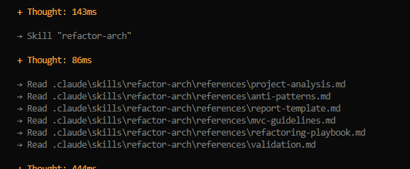 | 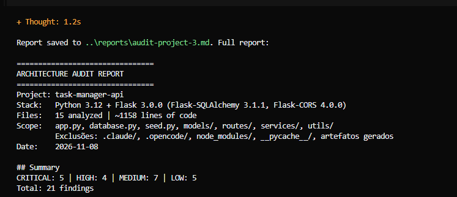 |

### Resumo dos relatórios de auditoria (`reports/`)

Os três relatórios gerados pela skill somam 63 achados (21 por projeto):

| Projeto | Stack | CRITICAL | HIGH | MEDIUM | LOW | Total | Principais riscos |
|---|---|---|---|---|---|---|---|
| `code-smells-project` | Python + Flask | 5 | 5 | 6 | 5 | 21 | SQL Injection, endpoint de SQL arbitrário, segredos hardcoded |
| `ecommerce-api-legacy` | Node.js + Express | 5 | 6 | 5 | 5 | 21 | credenciais e cartão em logs, hash fraco, bypass de login, God Class |
| `task-manager-api` | Python + Flask | 4 | 5 | 6 | 6 | 21 | MD5 sem salt, hash exposto na API, token JWT fake, rotas sem auth |
| **Total** | — | **14** | **16** | **17** | **16** | **63** | — |

**O que os números mostram:** os três projetos têm a mesma quantidade de achados, mas perfis diferentes. Os 14 CRITICAL se concentram em credenciais hardcoded, autenticação ausente/fraca e exposição de dados sensíveis — problemas de segurança que devem ser tratados antes de qualquer refatoração estrutural. Os padrões se repetem entre stacks: segredos no código, God Classes/Files, validações duplicadas, queries N+1 e tratamento de erro inconsistente. Isso mostra que a skill conseguiu identificar os mesmos anti-patterns em Python e Node.js, mantendo a classificação por severidade e as recomendações de separação em camadas MVC.

### Antes × depois da estrutura

| Projeto | Antes | Depois |
|---|---|---|
| `code-smells-project` | Monolito em 4 arquivos: `app.py` (rotas + admin perigoso + debug), `controllers.py`, `models.py` (SQL + regra + serialização) e `database.py` (conexão global + seed). | `config/`, `models/`, `views/`, `controllers/`, `middlewares/`, `services/` e `utils/`, com `app.py` como composition root. |
| `ecommerce-api-legacy` | 3 arquivos: `src/app.js`, `src/AppManager.js` (God Class) e `src/utils.js` (segredos + cache global + weak hash). | `src/config`, `db`, `models`, `services`, `controllers`, `routes`, `middlewares` e `utils`, com `src/app.js` como composition root. |
| `task-manager-api` | MVC parcial: `models/`, `routes/` gordas, `services/` e `utils/`; regra de negócio e validação dentro das rotas. | Controllers, config, middlewares, services e rotas finas; models com hash forte e DTO sem senha. |

As árvores completas estão em [`doc.md`](doc.md#62-antesdepois-da-estrutura).

### Checklist de validação preenchido

| Critério | Projeto 1 | Projeto 2 | Projeto 3 |
|---|---|---|---|
| Linguagem detectada corretamente | OK — Python | OK — JavaScript/Node | OK — Python |
| Framework detectado corretamente | OK — Flask 3.1.1 | OK — Express 4.18.2 | OK — Flask 3.0.0 |
| Domínio descrito corretamente | OK — E-commerce | OK — LMS/checkout | OK — Task Manager |
| Nº de arquivos condiz com a realidade | OK — 4 | OK — 3 | OK — 11 |
| Relatório segue o template | OK | OK | OK |
| Cada finding tem arquivo/linha | OK | OK | OK |
| Findings ordenados CRITICAL → LOW | OK | OK | OK |
| Mínimo de 5 findings | OK — 21 | OK — 21 | OK — 21 |
| APIs deprecated (se aplicável) | OK — nenhuma no source | OK — deps transitivas | OK — `utcnow` + `Query.get` |
| Pausa/confirmação antes da Fase 3 | OK | OK | OK |
| Estrutura de diretórios MVC | OK | OK | OK |
| Configuração em módulo (sem hardcoded) | OK | OK | OK |
| Models abstraem dados | OK | OK | OK |
| Views/Routes separadas | OK | OK | OK |
| Controllers concentram o fluxo | OK | OK | OK |
| Error handling centralizado | OK | OK | OK |
| Entry point claro | OK | OK | OK |
| Aplicação inicia sem erros | OK | OK | OK |
| Endpoints originais respondem | OK — 19/19* | OK — 3/3 | OK — 22/22 |

\* `POST /admin/query` foi desativado e responde `410 Gone`; `POST /admin/reset-db`
exige `X-Admin-Token`. No Projeto 2, as rotas admin exigem token apenas se
`ADMIN_TOKEN` estiver definido. No Projeto 3, `AUTH_REQUIRED=false` por padrão;
com `true`, todas as rotas exceto `/`, `/health` e `/login` exigem Bearer token.

### Evidências antes/depois

#### Projeto 1 — `code-smells-project`

| Antes | Depois |
|---|---|
| 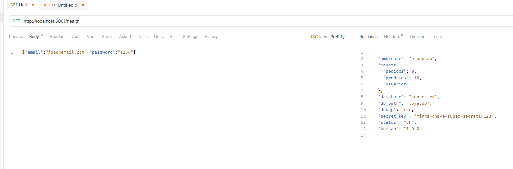 | 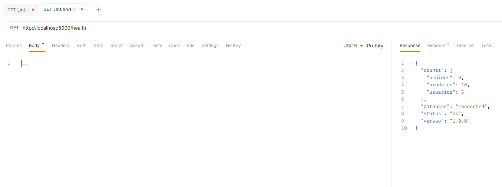 |
| `/health` expunha `secret_key` e `debug`. | `/health` devolve apenas contadores e status. |
| 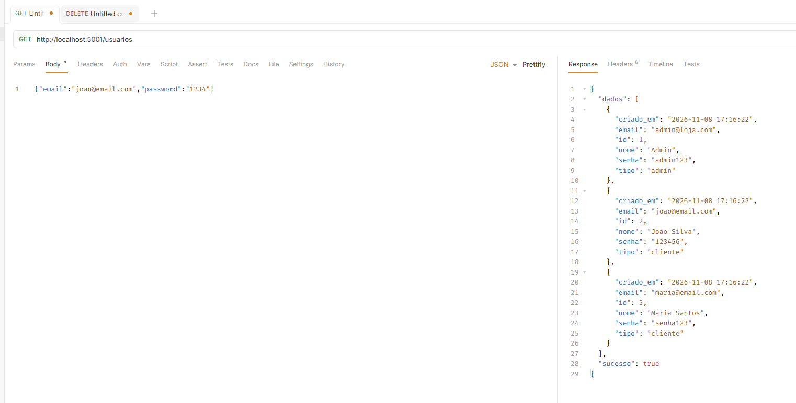 | 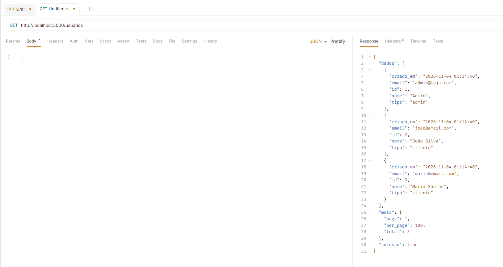 |
| `/usuarios` devolvia `senha` em texto puro. | `/usuarios` omite `senha` e inclui paginação. |
| 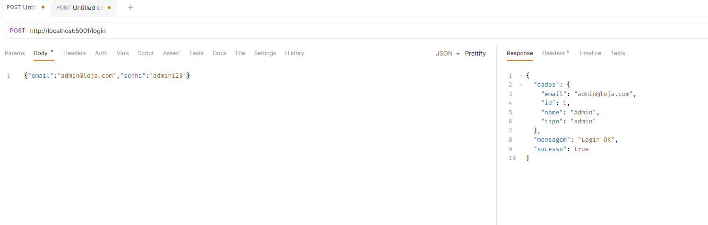 | 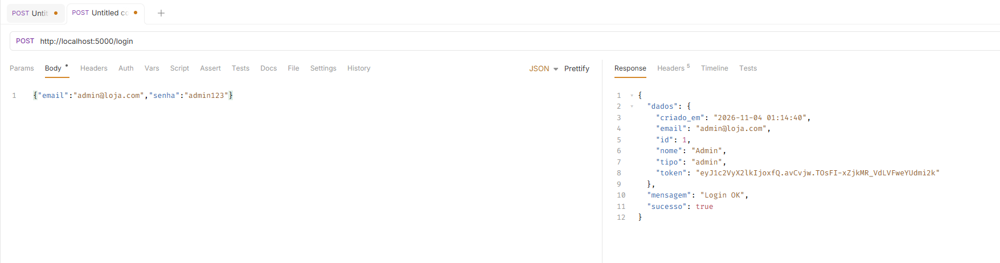 |
| Login respondia sem token. | Login devolve token assinado. |
| 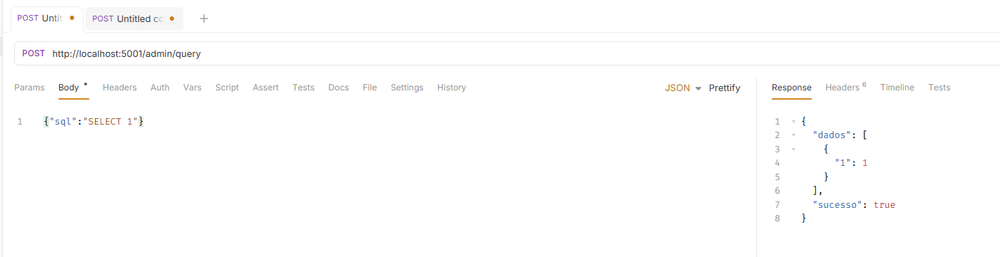 | 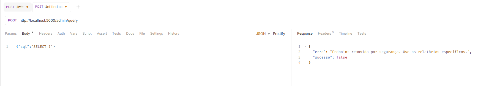 |
| `/admin/query` executava o SQL enviado pelo cliente. | `/admin/query` responde que o endpoint foi removido por segurança. |
| 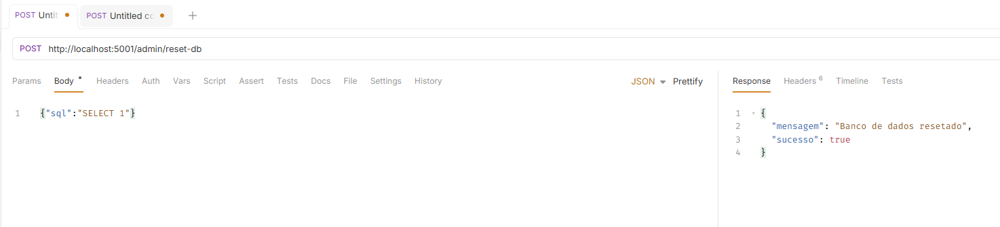 | 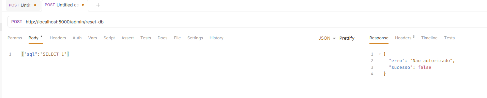 |
| `/admin/reset-db` apagava o banco sem autenticação. | `/admin/reset-db` responde não autorizado sem o token. |

#### Projeto 2 — `ecommerce-api-legacy`

| Antes | Depois |
|---|---|
| 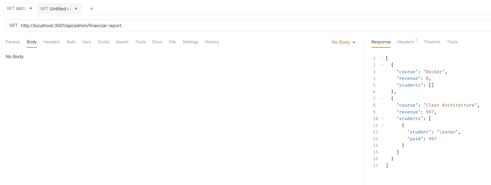 | 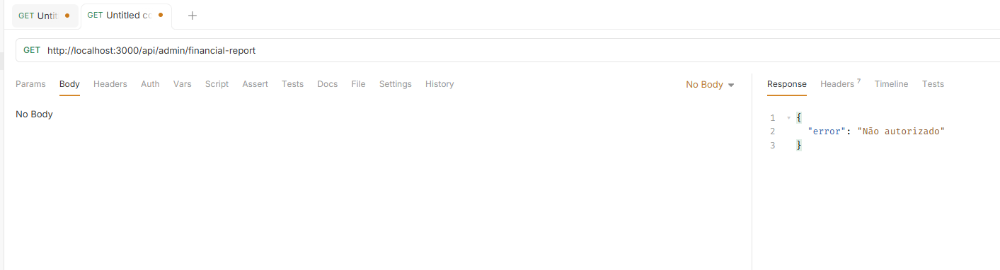 |
| O relatório financeiro era acessível sem autenticação. | O relatório exige `X-Admin-Token` quando `ADMIN_TOKEN` está definido. |
| 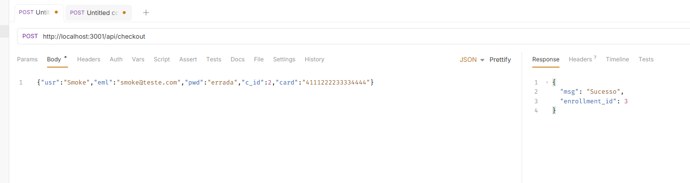 | 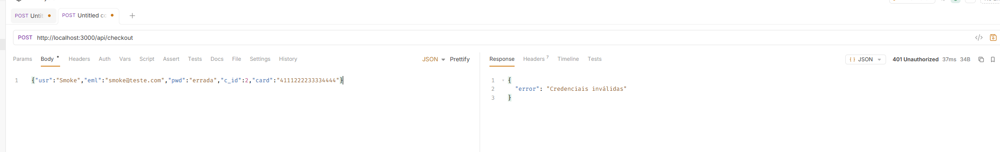 |
| Checkout aceitava senha errada e criava a matrícula. | Checkout devolve `401 Credenciais inválidas`. |

#### Projeto 3 — `task-manager-api`

| Antes | Depois |
|---|---|
| 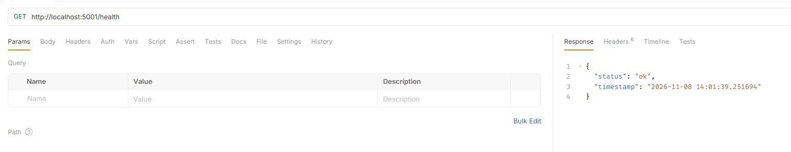 | 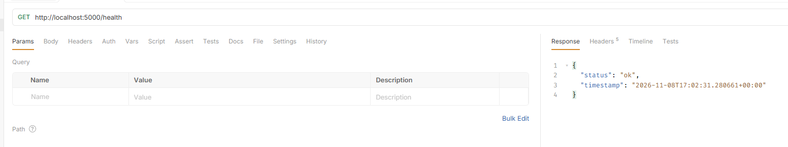 |
| Health respondia `200`. | Health continua respondendo `200` após a refatoração. |
| 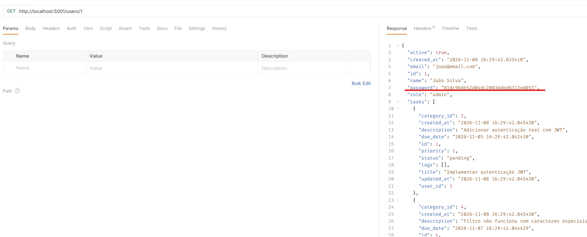 | 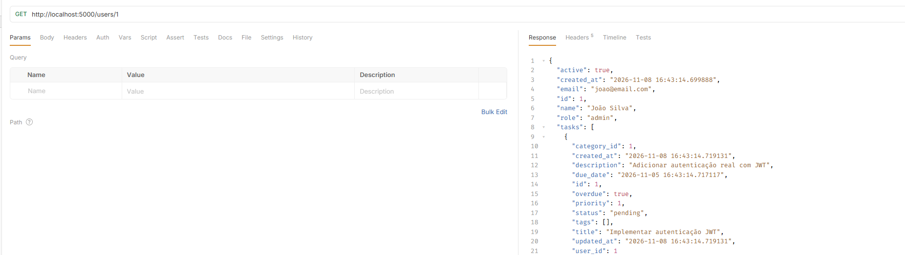 |
| `/users/1` expunha o hash da senha. | `/users/1` não devolve mais `password`. |
| 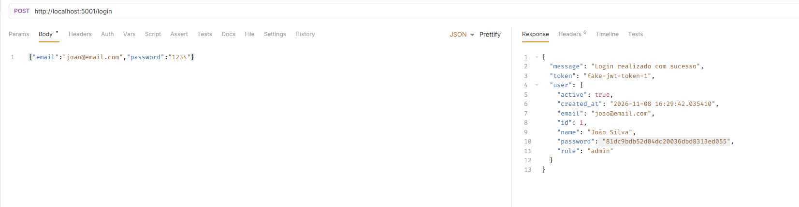 | 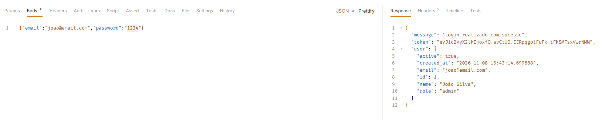 |
| Login devolvia `fake-jwt-token-1` e o hash da senha. | Login devolve um token assinado real e o usuário sem hash. |

### Logs pós-refatoração

```text
# Projeto 1
 * Serving Flask app 'app'
 * Debug mode: off
health: 200 {"counts":{"pedidos":0,"produtos":10,"usuarios":3},"database":"connected","status":"ok","versao":"1.0.0"}
OK: 35 requests validated
```

```text
# Projeto 2
{"timestamp":"2026-11-04T01:17:26.015Z","level":"info","message":"Frankenstein LMS rodando","meta":{"port":3000,"database":":memory:"}}
health: 200 {"status":"ok"}
OK: 20 checks passed
```

```text
# Projeto 3
 * Serving Flask app 'app'
 * Debug mode: off
health: 200 {"status":"ok","timestamp":"2026-11-04T01:24:21.081540+00:00"}
login: 200 token=True userHasPassword=False
OK: 31 requests validated + auth middleware
```

### Observações por stack

- **Projeto 1 (monolito Python/Flask):** a skill aplicou o conjunto completo de
  transformações, separou os quatro domínios e eliminou SQL Injection, senha em
  claro, endpoint de SQL arbitrário e estado global. Foi o caso de maior esforço
  estrutural.
- **Projeto 2 (Node/Express):** a skill adaptou o playbook para callbacks →
  Promises/async-await, transações serializadas, injeção de dependência no
  composition root e uma única query para o relatório. A simulação de pagamento
  por prefixo do cartão foi preservada, sem logar cartão ou chave.
- **Projeto 3 (Flask já organizado):** a skill não recriou a estrutura; adicionou
  controllers/config/middlewares, moveu regra das rotas para services, corrigiu
  segurança e substituiu APIs deprecated. Isso comprova a regra "evoluir, não
  reescrever".

### Riscos residuais

- **Projeto 1:** endpoints de negócio continuam públicos porque o original não
  tinha fluxo de login/autorização; as rotas administrativas foram protegidas.
- **Projeto 2:** a auth admin é opt-in e o `npm audit` ainda reporta
  vulnerabilidades em dependências transitivas; recomenda-se `npm audit fix` com
  testes antes de produção.
- **Projeto 3:** `AUTH_REQUIRED=false` por padrão para preservar compatibilidade;
  habilite em produção. Senhas de seed são fracas, embora agora hasheadas.

## Como validar a refatoração

### Smoke tests rápidos

```bash
# Projeto 1
curl http://127.0.0.1:5000/health
curl http://127.0.0.1:5000/produtos
curl http://127.0.0.1:5000/relatorios/vendas

# Projeto 2
curl http://127.0.0.1:3000/health
# se ADMIN_TOKEN estiver definido, adicione: -H "X-Admin-Token: seu-token-admin"
curl http://127.0.0.1:3000/api/admin/financial-report

curl -X POST http://127.0.0.1:3000/api/checkout \
  -H "Content-Type: application/json" \
  -d '{"usr":"Guilherme","eml":"gui@fullcycle.com.br","pwd":"senhaforte","c_id":2,"card":"4111222233334444"}'

# Projeto 3
curl http://127.0.0.1:5000/health
curl http://127.0.0.1:5000/tasks
curl http://127.0.0.1:5000/reports/summary

curl -X POST http://127.0.0.1:5000/login \
  -H "Content-Type: application/json" \
  -d '{"email":"joao@email.com","password":"1234"}'
```

> No Windows PowerShell, use `curl.exe` se o alias `curl` apontar para
> `Invoke-WebRequest`.

### Resultado esperado

| Projeto | Boot | Endpoints validados |
|---|---|---|
| Projeto 1 | `health` 200 | 19/19 (35 requisições) |
| Projeto 2 | `health` 200 | 3/3 (20 checks) |
| Projeto 3 | `health` 200 | 22/22 (31 requisições + auth) |

Os logs completos e o checklist estão em [`doc.md`](doc.md#64-logs-das-aplicações-rodando-após-a-refatoração).

## Documentação

- [`doc.md`](doc.md) — análise manual, construção da skill, anti-patterns, playbook, resultados, logs, riscos residuais e inventário de arquivos.
- [`reports/audit-project-1.md`](reports/audit-project-1.md)
- [`reports/audit-project-2.md`](reports/audit-project-2.md)
- [`reports/audit-project-3.md`](reports/audit-project-3.md)
- `code-smells-project/README.md`, `ecommerce-api-legacy/README.md` e `task-manager-api/README.md` — instruções específicas de cada projeto.
